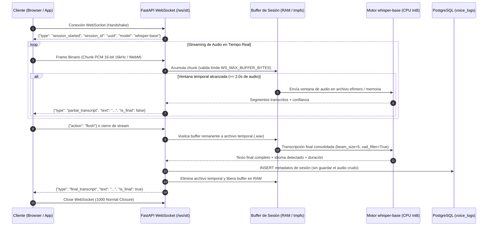
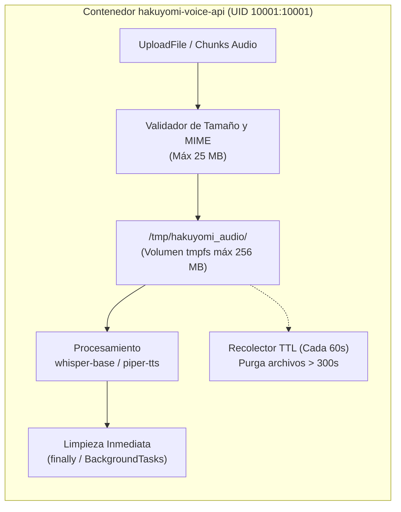

# Documento de Diseño Técnico — `hakuyomi-voice-api`

## 1. Visión General y Arquitectura

`hakuyomi-voice-api` es el servicio backend de procesamiento de voz (Speech-to-Text y Text-to-Speech) construido con **FastAPI** y **PostgreSQL**, empaquetado en un entorno **Docker limpio, endurecido (sin usuario `root`) y de huella ultraligera**.

### 1.1 Restricción Estricta de Tamaño (`< 10 GB`)

Para garantizar que el proyecto completo (imágenes Docker, dependencias de sistema, paquetes Python, modelos neuronales, base de datos y archivos temporales) pese **estrictamente menos de 10 GB**, se prohíbe la descarga de librerías CUDA/GPU pesadas (`nvidia-*`, `torch` con CUDA de ~3.5 GB) y de modelos masivos (`whisper-medium`, `whisper-large`, XTTS).

| Componente | Tecnología / Modelo | Peso Estimado |
| :--- | :--- | :--- |
| Imagen Base API | `python:3.11-slim` + `ffmpeg` (`--no-install-recommends`) | ~240 MB |
| Dependencias Python | `fastapi`, `sqlalchemy`, `asyncpg`, `faster-whisper`, `piper-tts`, `onnxruntime` (CPU) | ~260 MB |
| Modelo STT (Voz a Texto) | **`whisper-base`** (CTranslate2 `int8`, exclusivo) | **~140 MB** |
| Modelo TTS (Texto a Voz) | **`piper-tts` / VITS** (ONNX `es_MX-ald-medium`, exclusivo) | **~65 - 150 MB** |
| Base de Datos | `postgres:15-alpine` | ~85 MB |
| Almacenamiento Temporal | `/tmp/hakuyomi_audio` (`tmpfs` acotado con TTL) | Máx. 256 MB |
| **Total del Proyecto** | **Entorno Completo Construido** | **~1.05 GB (< 10 GB)** |

---

## 2. Modelos Ligeros Configurados

1. **Reconocimiento de Voz (STT) — `whisper-base` (~140 MB):**
   - Ejecutado sobre `faster-whisper` (motor CTranslate2 en CPU con cuantización `int8`).
   - Se valida por código y en el script de aprovisionamiento (`scripts/download_models.py`) que únicamente se permita `base` (o `tiny`), bloqueando explícitamente `small`, `medium` y `large`.
2. **Síntesis de Voz (TTS) — `piper-tts` / VITS (~150 MB):**
   - Basado en la arquitectura neuronal **VITS** (*Variational Inference with adversarial learning for end-to-end Text-to-Speech*) exportada a **ONNX Runtime** mediante `piper-tts`.
   - Provee inferencia en tiempo real sobre CPU sin requerir PyTorch completo.

---

## 3. Flujo de STT en Tiempo Real mediante WebSockets (`/ws/stt`)

El endpoint `WS /ws/stt` permite transcribir audio en tiempo real mediante *streaming* bidireccional de baja latencia entre el cliente y el motor `whisper-base`.

### 3.1 Diagrama de Secuencia del Flujo WebSocket

### 3.2 Protocolo de Mensajes y Gestión de Estado

1. **Apertura y Configuración (`Handshake`):**
   - Al conectar a `/ws/stt?lang=es`, el servidor asigna un `session_id` único (UUIDv4) e inicializa un buffer en memoria restringido por `WS_MAX_BUFFER_BYTES` (por defecto `10 MB` por sesión activa).
2. **Ingesta de Chunks Binarios:**
   - El cliente transmite paquetes binarios de audio (`bytes`, recomendablemente PCM 16-bit mono a 16 kHz o contenedores ligeros `.wav`/`.webm`).
   - Cada vez que el buffer supera el umbral de ventana (`WS_CHUNK_DURATION_MS`, por defecto `2000 ms` ≈ `64 KB` en PCM 16 kHz), el servidor ejecuta una inferencia rápida (`beam_size=1`, `vad_filter=True`) sobre `whisper-base` y emite un evento JSON `partial_transcript`.
3. **Consolidación (`flush`) y Cierre Limpio:**
   - Cuando el cliente envía `{"action": "flush"}` o cierra la conexión, se procesa el audio acumulado para emitir `final_transcript`, se persiste únicamente el registro de auditoría en PostgreSQL (`VoiceLog`) y el bloque `finally` destruye inmediatamente cualquier buffer o archivo temporal asociado a la sesión.

---

## 4. Almacenamiento Temporal de Archivos de Audio Adjuntos

Tanto la subida de archivos de audio por REST (`POST /api/v1/stt`) como la generación de audio sintetizado (`POST /api/v1/tts`) y los volcados auxiliares de WebSocket requieren almacenamiento efímero en el sistema de archivos.

### 4.1 Arquitectura del Directorio Temporal (`/tmp/hakuyomi_audio`)

### 4.2 Reglas de Ciclo de Vida y Limpieza Determinista

1. **Aislamiento en `tmpfs` Acotado:**
   - En `docker-compose.yml`, la ruta `/tmp/hakuyomi_audio` se monta como un sistema de archivos `tmpfs` limitado a `256 MB` con permisos exclusivos para el usuario sin privilegios (`uid=10001,gid=10001,mode=1770`). Esto garantiza velocidad de E/S en RAM y evita que los archivos temporales consuman disco o superen la cota de `< 10 GB`.
2. **Validación Previa a la Escritura:**
   - Se valida la extensión/MIME permitido (`.wav`, `.mp3`, `.ogg`, `.webm`, `.flac`, `.m4a`) y se lee el *stream* en fragmentos de `64 KB`. Si el archivo adjunto supera `MAX_UPLOAD_SIZE_MB` (25 MB), se aborta la escritura inmediatamente, se borra el archivo parcial y se devuelve `HTTP 413 Payload Too Large`.
3. **Triple Barrera de Limpieza Automática (`app/services/temp_storage.py`):**
   - **Barrera 1 — Context Manager Síncrono/Asíncrono (`try...finally`):** En `POST /api/v1/stt` y `WS /ws/stt`, el archivo adjunto se envuelve en un gestor de contexto que ejecuta `os.unlink()` en el bloque `finally` tan pronto termina la transcripción de `whisper-base` (incluso si ocurre una excepción).
   - **Barrera 2 — `BackgroundTasks` Post-Respuesta:** En `POST /api/v1/tts`, el archivo `.wav` generado por `piper-tts` se entrega con `FileResponse` adjuntando una tarea `BackgroundTask(remove_temp_file, path)` que lo elimina inmediatamente después de transmitir el último byte al cliente.
   - **Barrera 3 — Recolector Asíncrono por TTL:** Un *worker* ligero en segundo plano se ejecuta durante el ciclo de vida (`lifespan`) de FastAPI e inspecciona `/tmp/hakuyomi_audio` cada 60 segundos, eliminando cualquier archivo huérfano cuya antigüedad supere `TEMP_FILE_TTL_SECONDS` (`300 s`).

---

## 5. Persistencia en PostgreSQL

Para mantener la base de datos ligera y rápida, **nunca se almacenan blobs de audio (`BYTEA`) en PostgreSQL**. Solo se registran metadatos de operación en la tabla `voice_logs`:

- `id` (`UUID`, PK)
- `operation_type` (`VARCHAR`: `stt_rest`, `stt_ws`, `tts_rest`)
- `model_used` (`VARCHAR`: `whisper-base` o `piper-tts`)
- `input_text` / `output_text` (`TEXT`)
- `audio_duration_sec` (`FLOAT`, opcional)
- `processing_time_ms` (`FLOAT`)
- `created_at` (`TIMESTAMP WITH TIME ZONE`)

---

## 6. Seguridad del Contenedor (Ejecución No-Root)

El contenedor cumple buenas prácticas de endurecimiento OCI/Docker:
- Creación explícita del grupo `appgroup` (`GID 10001`) y usuario `appuser` (`UID 10001`) sin shell interactivo (`/usr/sbin/nologin`).
- Asignación de propietario `chown -R appuser:appgroup /app /tmp/hakuyomi_audio`.
- Directiva `USER appuser:appgroup` en `Dockerfile` y `user: "10001:10001"` en `docker-compose.yml`.
- Directivas `security_opt: ["no-new-privileges:true"]` y `cap_drop: ["ALL"]`.
