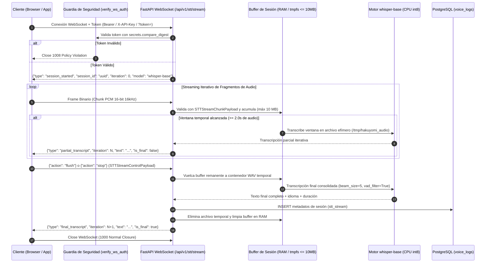
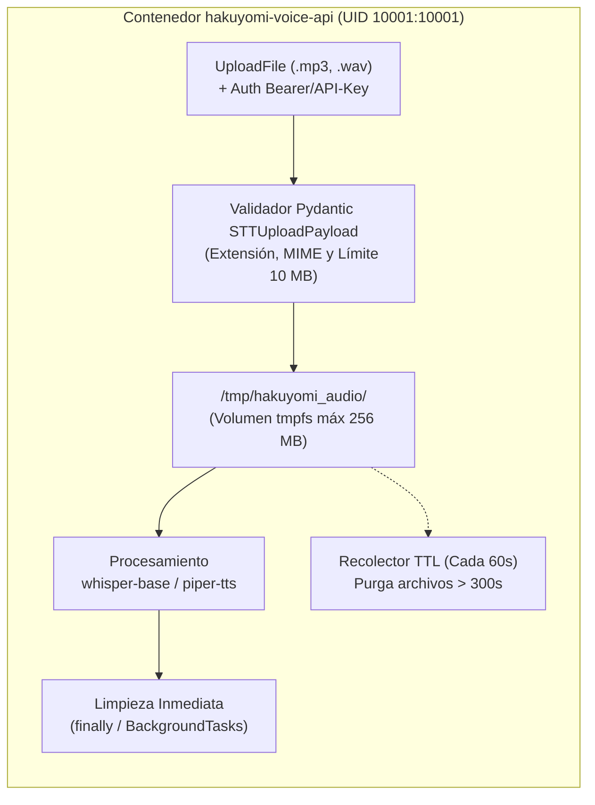

# Documento de Diseño Técnico — `hakuyomi-voice-api`

## 1. Visión General y Arquitectura

`hakuyomi-voice-api` es el servicio backend de procesamiento de voz (Speech-to-Text y Text-to-Speech) construido con **FastAPI** y **PostgreSQL**, empaquetado en un entorno **Docker limpio, endurecido (sin usuario `root`) y de huella ultraligera**.

### 1.1 Restricción Estricta de Tamaño (`< 10 GB`)

Para garantizar que el proyecto completo (imágenes Docker, dependencias de sistema, paquetes Python, modelos neuronales, base de datos y archivos temporales) pese **estrictamente menos de 10 GB**, se prohíbe la descarga de librerías CUDA/GPU pesadas (`nvidia-*`, `torch` con CUDA de ~3.5 GB) y de modelos masivos (`whisper-medium`, `whisper-large`, XTTS).

| Componente | Tecnología / Modelo | Peso Estimado |
| :--- | :--- | :--- |
| Imagen Base API | `python:3.11-slim` + `ffmpeg` (`--no-install-recommends`) | ~240 MB |
| Dependencias Python | `fastapi`, `sqlalchemy`, `asyncpg`, `faster-whisper`, `piper-tts`, `onnxruntime` (CPU) | ~260 MB |
| Modelo STT (Voz a Texto) | **`whisper-base`** (CTranslate2 `int8`, exclusivo) | **~140 MB** |
| Modelo TTS (Texto a Voz) | **`piper-tts` / VITS** (ONNX `es_MX-ald-medium`, exclusivo) | **~65 - 150 MB** |
| Base de Datos | `postgres:15-alpine` | ~85 MB |
| Almacenamiento Temporal | `/tmp/hakuyomi_audio` (`tmpfs` acotado con TTL) | Máx. 256 MB |
| **Total del Proyecto** | **Entorno Completo Construido** | **~1.05 GB (< 10 GB)** |

---

## 2. Modelos Ligeros Configurados

1. **Reconocimiento de Voz (STT) — `whisper-base` (~140 MB):**
   - Ejecutado sobre `faster-whisper` (motor CTranslate2 en CPU con cuantización `int8`).
   - Se valida por código y en el script de aprovisionamiento (`scripts/download_models.py`) que únicamente se permita `base` (o `tiny`), bloqueando explícitamente `small`, `medium` y `large`.
2. **Síntesis de Voz (TTS) — `piper-tts` / VITS (~150 MB):**
   - Basado en la arquitectura neuronal **VITS** (*Variational Inference with adversarial learning for end-to-end Text-to-Speech*) exportada a **ONNX Runtime** mediante `piper-tts`.
   - Provee inferencia en tiempo real sobre CPU sin requerir PyTorch completo.

---

## 3. Flujo de STT en Tiempo Real mediante WebSockets (`ws://.../api/v1/stt/stream`)

El endpoint `WS /api/v1/stt/stream` permite transcribir audio en tiempo real mediante *streaming* bidireccional de baja latencia e inferencia iterativa sobre `whisper-base`.

### 3.1 Diagrama de Secuencia del Flujo WebSocket

---

## 4. Almacenamiento Temporal de Archivos de Audio Adjuntos (`POST /api/v1/stt/upload`)

Tanto la subida de archivos de audio adjuntos por HTTP (`POST /api/v1/stt/upload`) como la generación de audio sintetizado (`POST /api/v1/tts`) y los volcados auxiliares de WebSocket emplean almacenamiento efímero endurecido.

### 4.1 Arquitectura del Directorio Temporal (`/tmp/hakuyomi_audio`)

### 4.2 Validaciones Estandarizadas y Triple Barrera de Limpieza

1. **Autenticación en Cada Ruta (`app/core/security.py`):**
   - Las rutas HTTP (`/api/v1/stt/upload`, `/api/v1/tts`) exigen `Depends(verify_http_auth)` y el endpoint WebSocket (`/api/v1/stt/stream`) ejecuta `verify_ws_auth`, validando el token en tiempo constante con `secrets.compare_digest`.
2. **Validación Pydantic y Límite Estricto de 10 MB (`app/schemas/voice.py`):**
   - `STTUploadPayload` restringe las extensiones permitidas exclusivamente a `.mp3` y `.wav`, valida el `Content-Type` y aplica el límite de tamaño máximo de **`10 MB` (`MAX_UPLOAD_SIZE_MB=10`)** tanto en cabecera como durante la lectura por *chunks* de `64 KB` (devolviendo `HTTP 413` si se supera).
3. **Triple Barrera de Limpieza Automática (`app/services/temp_storage.py`):**
   - **Barrera 1 — Context Manager Asíncrono (`try...finally`):** En `POST /api/v1/stt/upload` y `WS /api/v1/stt/stream`, el archivo adjunto se elimina garantizadamente en el bloque `finally` tras completar la inferencia con `whisper-base`.
   - **Barrera 2 — `BackgroundTasks` Post-Respuesta:** En `POST /api/v1/tts`, el archivo `.wav` generado por `piper-tts` se elimina inmediatamente tras concluir el envío de `FileResponse`.
   - **Barrera 3 — Recolector Asíncrono por TTL:** Un *worker* en segundo plano inspecciona `/tmp/hakuyomi_audio` cada 60 segundos y purga cualquier archivo con antigüedad mayor a `TEMP_FILE_TTL_SECONDS` (`300 s`).

---

## 5. Seguridad del Contenedor (Ejecución No-Root)

El contenedor cumple buenas prácticas de endurecimiento OCI/Docker:
- Grupo `appgroup` (`GID 10001`) y usuario `appuser` (`UID 10001`) sin shell interactivo (`/usr/sbin/nologin`).
- Directiva `USER appuser:appgroup` en `Dockerfile` y `user: "10001:10001"` en `docker-compose.yml`.
- Directivas `security_opt: ["no-new-privileges:true"]` y `cap_drop: ["ALL"]`.
